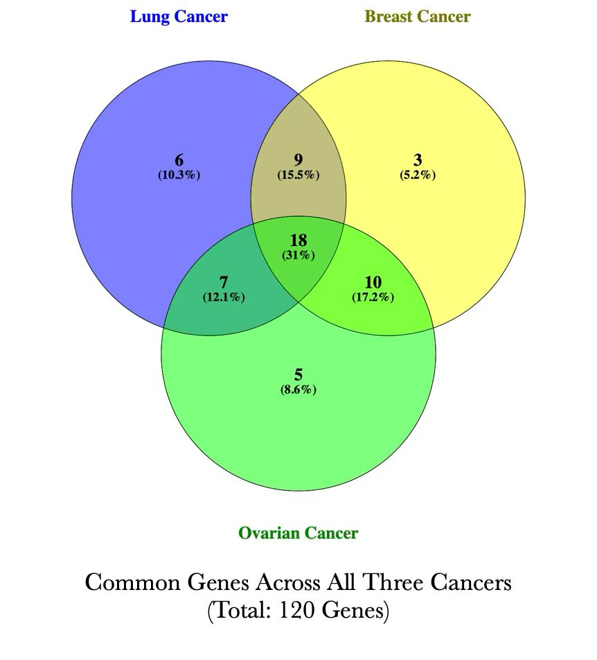
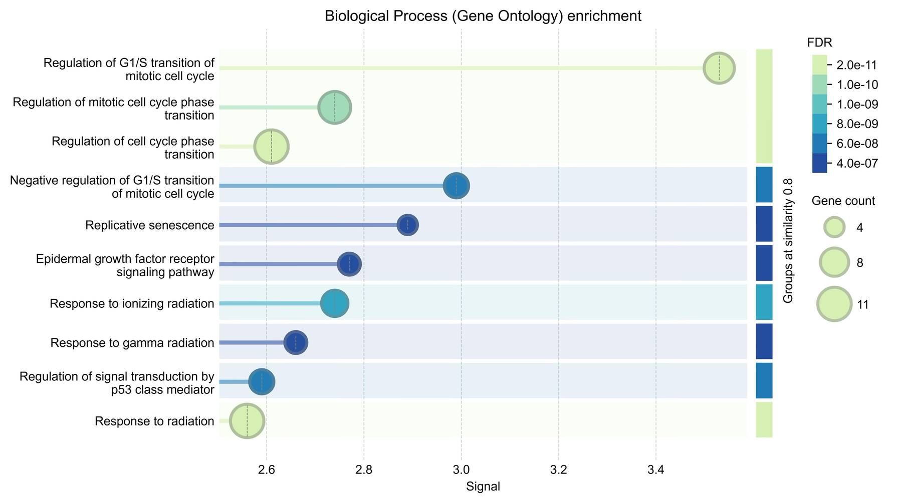
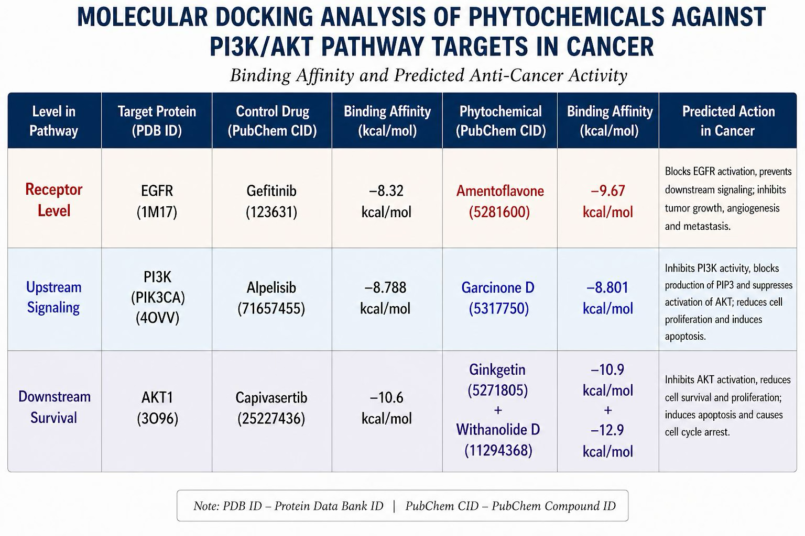
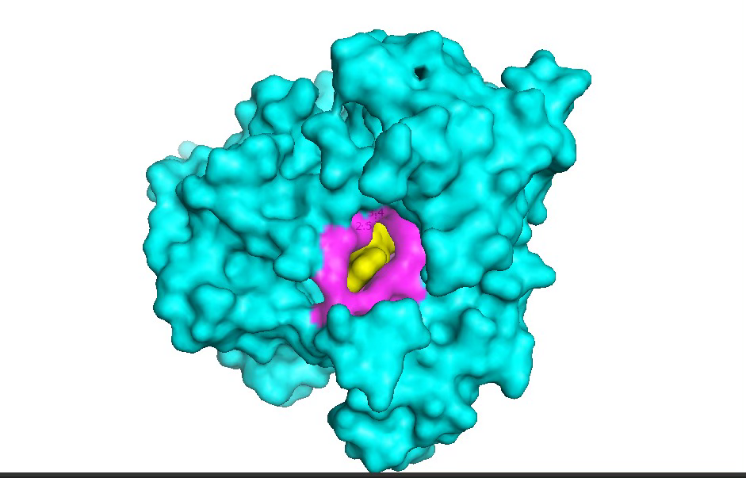
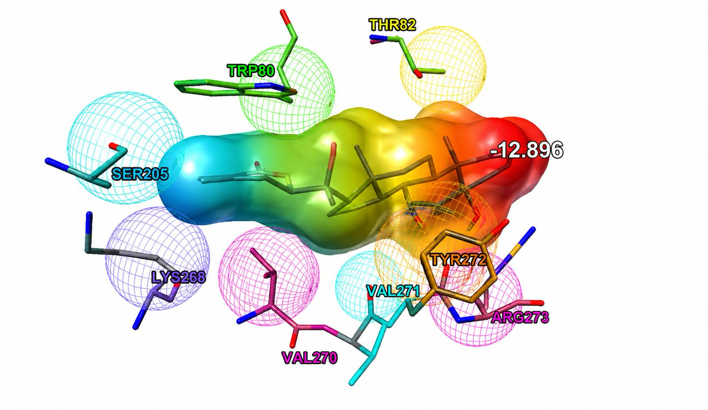
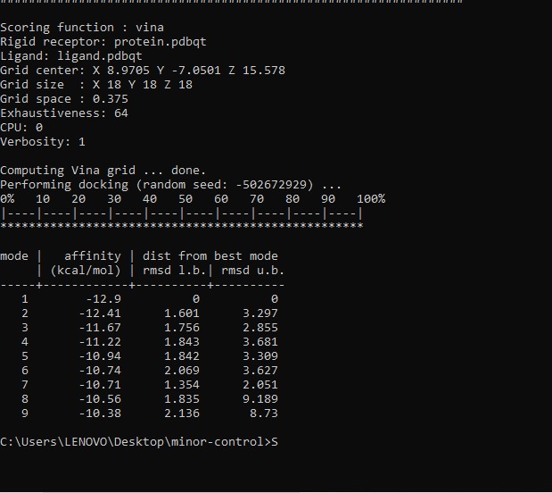

# Multi-Cancer Hub Gene Analysis and Phytochemical Docking

**Comparative bioinformatics and molecular docking study of lung, breast and ovarian cancers, targeting the PI3K/AKT pathway with phytochemicals.**

B.Tech Bioinformatics minor project, Department of Biotechnology, IILM University, Greater Noida (2025-26)

**Team:** B.Tech Bioinformatics project team
**Supervisor:** Dr. Pankaj Verma, Assistant Professor, Department of Biotechnology, IILM University

## Overview

Lung, breast and ovarian cancers differ in origin and progression but share dysregulated signaling. This project integrates gene expression analysis, protein-protein interaction (PPI) networks, pathway enrichment and molecular docking to:

1. Find genes shared across the three cancers and identify hub genes.
2. Show which pathway these genes converge on (PI3K/AKT).
3. Test whether phytochemicals bind pathway targets (EGFR, PI3K, AKT1) as well as standard drugs, in silico.

## Workflow

```
Gene identification (TCGA, GEO, GeneCards)
  -> PPI network (STRING, Cytoscape)
  -> Hub gene selection (degree centrality)
  -> Pathway enrichment (KEGG, STRING GO)
  -> Target selection (EGFR, PI3K, AKT1)
  -> Ligand retrieval (PubChem) -> ADME check (SwissADME)
  -> Molecular docking (AutoDock Vina)
  -> Interaction analysis (PyMOL, UCSF ChimeraX)
```

## Tools and data

| Step | Tool / source |
|---|---|
| Expression data and gene lists | TCGA, GEO (GSE15852), GeneCards |
| Differential expression | GEO2R |
| Common genes | Venn diagram analysis |
| PPI network and hubs | STRING, Cytoscape |
| Pathway and GO enrichment | KEGG, STRING |
| Protein structures | RCSB Protein Data Bank |
| Ligands | PubChem |
| ADME / drug-likeness | SwissADME |
| Docking | AutoDock Vina |
| Visualization | PyMOL, UCSF ChimeraX |

## Results

### Common genes

Starting from a 120-gene list, a Venn analysis found **18 genes common to all three cancers**.



### Hub genes and pathway enrichment

Network analysis (STRING + Cytoscape, degree centrality) placed **TP53, PIK3CA, AKT1, EGFR and PTEN** among the central regulators. KEGG and GO enrichment pointed to the **PI3K/AKT signaling pathway** as the shared pathway, linked to cell proliferation, survival, apoptosis and signal transduction.



### Molecular docking (AutoDock Vina)

| Level | Target (PDB) | Control drug | Control (kcal/mol) | Phytochemical | Phytochemical (kcal/mol) |
|---|---|---|---|---|---|
| Receptor | EGFR (1M17) | Gefitinib | -8.32 | Amentoflavone | -9.67 |
| Upstream | PI3K (4OVV) | Alpelisib | -8.788 | Garcinone D | -8.801 |
| Downstream | AKT1 (3O96) | Capivasertib | -10.6 | Ginkgetin / Withanolide D | -10.9 / -12.9 |

**Strongest binding:** Withanolide D with AKT1 at -12.9 kcal/mol, compared with -10.6 kcal/mol for the control drug Capivasertib.



| Withanolide D - AKT1 | Binding site interactions |
|---|---|
|  |  |

AutoDock Vina run output (exhaustiveness 64, best mode -12.9 kcal/mol):



## Conclusion

The three cancers share hub genes that converge on PI3K/AKT signaling. In docking, several phytochemicals scored equal to or better than standard inhibitors, with Withanolide D and AKT1 the strongest pair. The hub genes are also candidate diagnostic and prognostic biomarkers.

## Limitations

These are computational predictions from docking scores. They have not been validated experimentally, and a binding score does not prove inhibition or therapeutic effect.

## Future work

- In vitro and in vivo validation of the top phytochemicals
- Pharmacokinetics, toxicity and synergy with existing chemotherapy
- Molecular dynamics simulations for binding stability
- Multi-omics integration and ML-based target prediction

## References

1. Mustafa, G., et al. (2023). Molecular docking and simulation-binding analysis of plant phytochemicals with cancer targets. *Molecules*, 28(8), 3583.
2. Aggarwal, B. B., & Sung, B. (2016). Molecular mechanisms of cancer prevention by phytochemicals. In *Bioactive Food Components in Cancer Prevention* (pp. 1-23). Springer.
3. Dogra, A., & Kumar, J. (2023). Biosynthesis of anticancer phytochemical compounds and their chemistry. *Frontiers in Pharmacology*, 14, 1136779.
4. Kumar, V., Abbas, A. K., & Aster, J. C. (2020). *Robbins & Cotran Pathologic Basis of Disease* (10th ed.). Elsevier.
5. NCBI. Gene Expression Omnibus (GEO). https://www.ncbi.nlm.nih.gov/geo/
